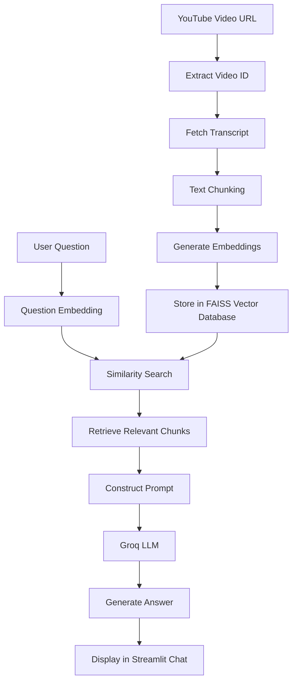

# YouTube Transcript Chatbot

A learning project built to explore **Retrieval-Augmented Generation (RAG)** using LangChain, Hugging Face embeddings, FAISS, and Groq LLMs.

This application allows users to load a YouTube video, retrieve its transcript, and interact with the content through an AI-powered chatbot. Instead of asking an LLM to answer questions from its general knowledge, the chatbot retrieves relevant portions of the video's transcript and uses them as context to generate answers.

The project was developed as a hands-on learning experience to understand how a RAG pipeline works, from data extraction and chunking to embedding generation, vector search, retrieval, prompt augmentation, and response generation.

> **Note:** This is a learning project and an experimental implementation of a RAG-based chatbot. It is not intended to be a fully production-ready application.

---

## Project Overview

The idea behind this project is to make YouTube videos easier to understand and interact with.

Instead of watching an entire video to find a particular piece of information, users can load a video and ask questions directly about its content.

The chatbot retrieves relevant information from the video's transcript and generates answers using a Large Language Model (LLM).

### Example Use Cases

- Summarizing long YouTube videos
- Extracting key takeaways from lectures or tutorials
- Asking questions about specific topics discussed in a video
- Understanding technical explanations
- Revisiting information without manually searching through the video
- Exploring educational content interactively

---

## Features

- **YouTube Video Integration:** Load videos using a YouTube URL or video ID.
- **Transcript Extraction:** Automatically fetches available English transcripts using `youtube-transcript-api`.
- **Text Chunking:** Splits the transcript into smaller overlapping chunks for better retrieval.
- **Semantic Search:** Uses Hugging Face embeddings to represent transcript chunks as vectors.
- **Vector Database:** Stores and searches embeddings using FAISS.
- **Retrieval-Augmented Generation:** Retrieves relevant transcript chunks before generating an answer.
- **AI-Powered Responses:** Uses Groq-hosted LLMs to answer questions based on the retrieved context.
- **Interactive Chat Interface:** Built using Streamlit.
- **Video Playback:** Displays the loaded YouTube video directly inside the application.
- **Suggested Questions:** Provides predefined questions to help users get started.
- **Session-Based Chat History:** Maintains the conversation during the current Streamlit session.
- **Conversation Reset:** Allows users to clear the chat history.
- **Caching:** Uses Streamlit's resource caching to avoid rebuilding the same RAG pipeline unnecessarily.

---

## How It Works

The project follows a basic Retrieval-Augmented Generation (RAG) architecture.

Instead of directly sending the entire transcript to the LLM, the transcript is processed and indexed. When a user asks a question, the system retrieves the most relevant portions of the transcript and uses them as context for the LLM.

### RAG Pipeline



### Step 1: Extract the YouTube Video ID

The application accepts different types of YouTube URLs, including:

- Standard YouTube URLs
- `youtu.be` URLs
- YouTube Shorts URLs
- Embedded video URLs
- Live video URLs
- Direct video IDs

The video ID is extracted using Python's `re` and `urllib.parse` modules.

The extracted ID is then used to fetch the video's transcript.

### Step 2: Fetch the Transcript

The `youtube-transcript-api` library is used to fetch the available English transcript of the video.

The transcript is converted into a single string containing the complete textual content.

This transcript becomes the primary data source for the chatbot.

### Step 3: Chunking

Long transcripts are divided into smaller chunks using LangChain's `RecursiveCharacterTextSplitter`.

The current configuration is:

```python
chunk_size = 1000
chunk_overlap = 200
```

This means each chunk contains approximately 1000 characters, with 200 characters overlapping between consecutive chunks.

Chunking helps the retrieval system identify smaller, relevant sections of the transcript instead of searching through the entire transcript at once.

The overlap also helps preserve context when an explanation or sentence is split between two chunks.

### Step 4: Embedding Generation

Each transcript chunk is converted into a numerical vector using the Hugging Face embedding model:

```text
all-MiniLM-L6-v2
```

Embeddings represent the semantic meaning of the text.

This allows the chatbot to retrieve chunks based on the meaning of a question rather than relying only on exact keyword matching.

For example, a question such as:

> What is the main objective of the project?

may retrieve a transcript chunk containing:

> The project was developed to help users interact with video content more efficiently.

Even though the exact words are different, the semantic similarity can help identify the relevant information.

### Step 5: Vector Storage Using FAISS

The generated embeddings are stored in a FAISS vector store.

FAISS is used to perform efficient similarity searches between the user's question and the embedded transcript chunks.

The vector store is created using:

```python
vector_store = FAISS.from_documents(chunks, embeddings)
```

### Step 6: Retrieval

When the user asks a question, the retriever searches the vector database for the most relevant transcript chunks.

The current retrieval configuration is:

```python
retriever = vector_store.as_retriever(
    search_type="similarity",
    search_kwargs={"k": 4}
)
```

The system retrieves the top four chunks that are semantically similar to the question.

These chunks are then combined into a context string.

### Step 7: Prompt Augmentation

The retrieved transcript content is inserted into a prompt along with the user's question.

The prompt instructs the LLM to:

- Answer using only the provided transcript context.
- Avoid inventing information.
- Provide clear and reasonably detailed answers.
- Acknowledge when the transcript does not contain enough information.

This step is important because it grounds the generated answer in the video transcript.

### Step 8: Response Generation

The augmented prompt is sent to the Groq-hosted LLM.

The model currently used in the application is:

```text
openai/gpt-oss-120b
```

The generated response is then displayed in the Streamlit chat interface.

---

## Tech Stack

| Technology | Purpose |
|---|---|
| Python | Core programming language |
| Streamlit | Web application and interactive UI |
| LangChain | RAG pipeline orchestration |
| YouTube Transcript API | Extracting video transcripts |
| Hugging Face | Text embedding generation |
| all-MiniLM-L6-v2 | Embedding model |
| FAISS | Vector database and similarity search |
| Groq | LLM inference |
| python-dotenv | Loading environment variables |
| Jupyter Notebook | Experimentation and understanding the RAG pipeline |

---

## Project Structure

```text
Youtube-Chatbot/
│
├── .venv/                       # Local Python virtual environment
│
├── .env                         # API keys and environment variables
│
├── app.py                       # Main Streamlit application
│
├── requirements.txt              # Python dependencies
│
├── Youtube_chatbot.ipynb        # RAG experimentation notebook
│
├── Youtube_chatbot.py            # Python script version of the notebook
│
└── README.md                     # Project documentation
```

### File Details

#### `app.py`

The main application file.

This file contains the complete Streamlit application, including:

- Streamlit page configuration
- Custom UI styling
- YouTube video ID extraction
- Transcript fetching
- Text chunking
- Embedding generation
- FAISS vector store creation
- Retriever configuration
- Prompt construction
- LangChain pipeline
- Streamlit session state management
- YouTube video player
- Chat interface
- Suggested questions
- Error handling
- Conversation clearing

The RAG pipeline is implemented inside the `build_chain()` function.

The application uses Streamlit's `@st.cache_resource` decorator to cache the generated RAG chain for a video ID.

This helps prevent unnecessary transcript fetching, embedding generation, and vector store creation when the application reruns.

#### `Youtube_chatbot.ipynb`

This Jupyter Notebook contains the step-by-step development and experimentation of the RAG pipeline.

It was used to understand and implement the individual components before integrating them into the Streamlit application.

The notebook includes:

1. Transcript extraction
2. Text chunking
3. Embedding generation
4. FAISS vector store creation
5. Retriever construction
6. Retrieval testing
7. Prompt construction
8. LLM response generation
9. Building a LangChain chain using `RunnableParallel`
10. Testing the complete RAG pipeline

This notebook represents the learning and experimentation phase of the project.

#### `Youtube_chatbot.py`

A Python script version of the notebook's initial implementation.

It contains the early stages of the pipeline:

- Fetching a YouTube transcript
- Chunking the transcript
- Printing the number of generated chunks

This file is retained as part of the project's development process.

#### `requirements.txt`

Contains the Python packages required by the project.

The dependencies are used for:

- LangChain
- LLM integrations
- Hugging Face models
- Environment variable management
- Machine learning utilities

The dependency list may require updates as the project evolves.

#### `.env`

Stores environment variables and API credentials required by the application.

For example:

```env
GROQ_API_KEY=your_groq_api_key
```

The API key is loaded using `python-dotenv`.

**Never upload your `.env` file to GitHub.**

#### `.venv`

A local Python virtual environment containing the installed packages for this project.

This directory is machine-specific and should not be included in the GitHub repository.

---

## Installation and Setup

### 1. Clone the Repository

```bash
git clone https://github.com/YOUR_USERNAME/YOUR_REPOSITORY_NAME.git
```

Navigate to the project directory:

```bash
cd YOUR_REPOSITORY_NAME
```

### 2. Create a Virtual Environment

```bash
python -m venv .venv
```

### 3. Activate the Virtual Environment

**Windows:**

```bash
.venv\Scripts\activate
```

**Linux / macOS:**

```bash
source .venv/bin/activate
```

### 4. Install Dependencies

```bash
pip install -r requirements.txt
```

Depending on the current contents of `requirements.txt`, additional packages used by `app.py` may need to be installed. Make sure the application dependencies listed below are available.

### 5. Configure Environment Variables

Create a `.env` file in the root directory.

```env
GROQ_API_KEY=your_groq_api_key
```

You can obtain a Groq API key from the Groq developer platform.

The application uses this key to access the LLM.

### 6. Run the Application

```bash
streamlit run app.py
```

The application should open in your default browser.

If it does not open automatically, Streamlit will provide a local URL, usually:

```text
http://localhost:8501
```

---

## Using the Application

### 1. Load a YouTube Video

Enter the video title and paste the YouTube video URL or video ID.

Click:

```text
Load video and transcript
```

The application will:

- Validate the video ID
- Fetch the English transcript
- Split the transcript into chunks
- Generate embeddings
- Create the FAISS vector store
- Configure the retriever
- Build the RAG chain

### 2. Watch the Video

Once loaded, the video player is displayed inside the application.

The application also displays:

- Video ID
- Transcript index status
- Number of chunks generated

### 3. Ask Questions

Use the chat interface to ask questions about the video's content.

Examples:

```text
Summarize this video.
```

```text
What are the key takeaways?
```

```text
Explain the main concept discussed in the video.
```

```text
What does the speaker say about this topic?
```

```text
What are the most important points discussed?
```

The chatbot retrieves relevant transcript sections and uses them to generate an answer.

### 4. Clear the Conversation

The application provides a button to clear the current conversation.

This removes the displayed chat history from the current Streamlit session.

---

## LangChain Pipeline

The final RAG chain is constructed using LangChain's Runnable components.

The pipeline uses:

- `RunnableParallel`
- `RunnablePassthrough`
- `RunnableLambda`
- `PromptTemplate`
- `StrOutputParser`

The parallel chain prepares two inputs:

```python
parallel_chain = RunnableParallel(
    {
        "context": retriever | RunnableLambda(format_docs),
        "question": RunnablePassthrough(),
    }
)
```

The retriever searches the transcript and the retrieved documents are formatted into a single context string.

The user's question is passed through unchanged.

The final chain is:

```python
chain = parallel_chain | prompt | model | StrOutputParser()
```

This represents the complete flow:

```text
Question
   ↓
Retriever
   ↓
Relevant Transcript Chunks
   ↓
Context Formatting
   ↓
Prompt Template
   ↓
LLM
   ↓
Output Parser
   ↓
Final Answer
```

---

## Learning Objectives

This project helped explore and understand the following concepts:

- Large Language Models (LLMs)
- Retrieval-Augmented Generation (RAG)
- Text preprocessing
- Text chunking
- Chunk overlap
- Embeddings
- Semantic similarity
- Vector databases
- FAISS
- Information retrieval
- Prompt engineering
- Context augmentation
- LangChain Runnable architecture
- RunnableParallel
- RunnablePassthrough
- RunnableLambda
- Output parsing
- Streamlit application development
- API integration
- Environment variables
- Caching
- Session state management

---

## Limitations

This project is still a learning implementation and has some limitations.

### Transcript Availability

The chatbot depends on the availability of transcripts or captions for the YouTube video.

Videos without accessible transcripts cannot be processed.

### Language Support

The current implementation fetches English transcripts.

Videos with transcripts available only in other languages may not work as expected.

### Transcript-Based Answers

The chatbot only has access to the transcript.

It does not analyze:

- Video frames
- Visual demonstrations
- Images displayed in the video
- Audio tone or emotion
- Information that is not included in the transcript

### Retrieval Limitations

The retriever currently uses similarity search and retrieves four chunks.

Depending on the question, relevant information may not always be retrieved.

### Hallucinations

Although the prompt instructs the LLM to answer only using transcript context, the model may still occasionally generate inaccurate or unsupported information.

### Temporary Vector Store

The FAISS vector store is currently created in memory.

The embeddings and vector index are not permanently saved to disk.

### Session-Based Chat History

The conversation history is maintained using Streamlit session state.

It is not stored in a persistent database and may be lost when the session ends or is reset.

### API Dependency

The application requires a valid Groq API key and depends on the availability of the external API.

---

## Future Improvements

Some possible improvements for future versions include:

- Persistent vector storage
- Support for multiple languages
- Better transcript preprocessing
- Improved chunking strategies
- Retrieval evaluation
- More advanced retrieval techniques
- Hybrid search
- Reranking retrieved chunks
- Conversation-aware retrieval
- Persistent chat history
- Video metadata extraction
- Automatic video title extraction
- Transcript timestamps in answers
- Citation of transcript sections
- Support for playlists
- Support for multiple videos simultaneously
- Better error handling
- Deployment to a cloud platform

---

## About the Project

This project was developed as a hands-on learning project to understand how Retrieval-Augmented Generation systems can be built using LangChain and related tools.

The implementation began with experimenting with the individual components in a Jupyter Notebook and gradually progressed into an interactive Streamlit application.

The main goal was not to build a complete production-level chatbot, but to understand the working of a RAG pipeline and implement it from scratch using commonly used tools in the Generative AI ecosystem.

---

## License

This project is created for educational and learning purposes.

Feel free to explore the code, experiment with the implementation, and build upon it.
